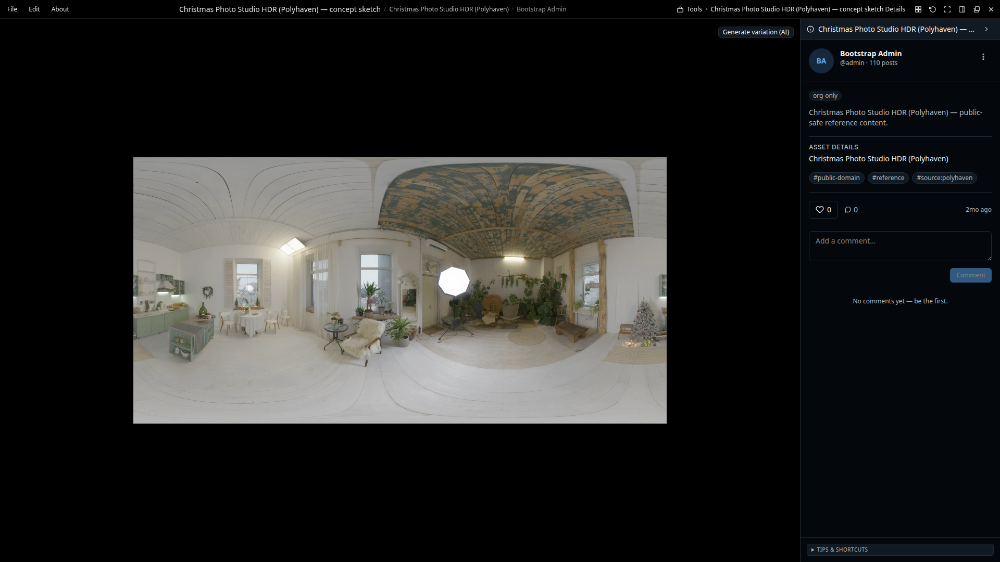
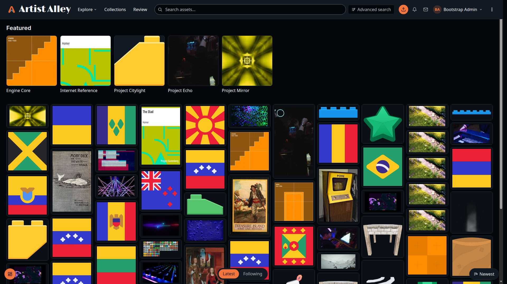
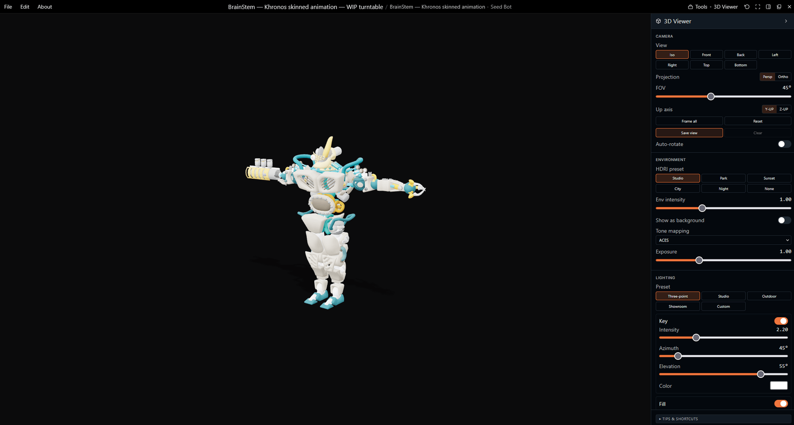
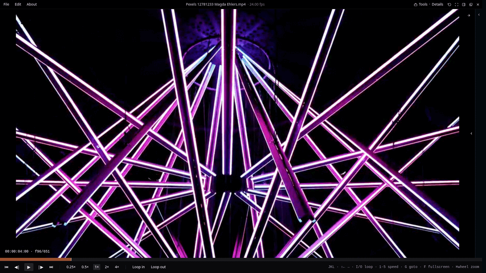
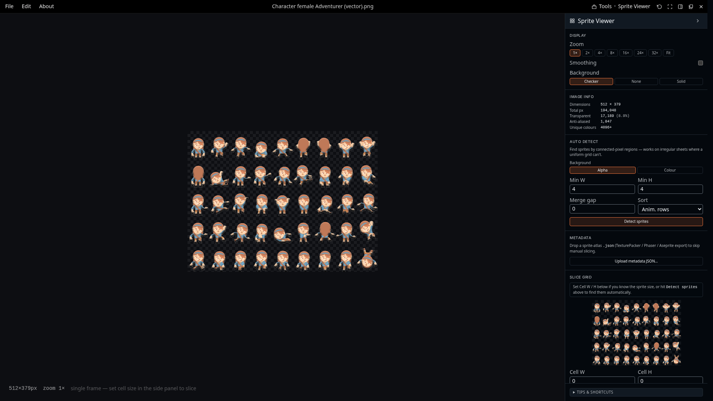

# Artist Alley

[](https://github.com/Artist-Alley-Org/artist-alley/releases/latest)
[](https://artist-alley.org)
[](LICENSE)

Art review should stay close to the work. Artist Alley gives game studios one place to post artwork, talk through changes, and find the finished piece later. It is self-hosted, so the studio keeps its own library.

**Artist Alley is in active, pre-1.0 development.** It is ready to explore and help shape, but not yet recommended for a production library. See the [latest release](https://github.com/Artist-Alley-Org/artist-alley/releases/latest) for what has shipped.

## What you can do today

- **Bring work together.** Upload images, video, audio, documents, sprite sheets, and 3D models. Keep a model's companion files with it, make posts and collections, and leave drafts until they are ready.
- **Review in context.** Leave threaded comments on posts and assets, browse the work in several views, and search across posts, artwork, and collections. Visibility rules carry through the feed and search results.
- **Describe work your way.** Studios can define their own metadata fields and vocabularies, then preview and apply edits across many files at once.
- **Run your own instance.** The app runs with PostgreSQL and local or S3-compatible storage. Two instances can pair through [ArchivePub](docs/spec/federation/v1.md) and exchange likes and comments; broader cross-studio sharing is still planned.

The public [read-only demo](https://demo.artist-alley.org/) is a quick way to look around. Its sample artwork has different source licenses; see [the attributions](seed/ATTRIBUTIONS.md) before reusing any of it.

## A look inside





<details>
<summary>More views</summary>





</details>

## Run it locally

You need Docker with Compose v2 and OpenSSL. From a fresh clone:

```bash
git clone https://github.com/Artist-Alley-Org/artist-alley.git
cd artist-alley
./scripts/bootstrap.sh
```

The script creates a local `.env` with fresh secrets, builds the app, starts the containers, and prints the address to open. With the supplied defaults, that is [localhost:8088](http://localhost:8088). On a fresh local development install, sign in as `admin` with password `ArtistAlleyMogul`.

To see what the containers are doing, run `docker compose logs -f`. Stop them with `docker compose down`; the named volumes keep your local data. This Compose setup is for local evaluation. For an instance other people will use, start with the [installation guide](docs/install/README.md) and change the development credentials and defaults.

## What comes next

The next work strengthens ArchivePub's record of files, rights, and preservation history. After that, the focus moves toward reviewing together: shared sessions, a collaborative canvas, and better inspectors for creative work. The [roadmap](docs/roadmap.md) gives the direction without treating every planned feature as a date promise. [GitHub milestones](https://github.com/Artist-Alley-Org/artist-alley/milestones) track the current release scope.

## For contributors

The Go app serves the API and embeds the SvelteKit interface; PostgreSQL stores the library's records. The [developer documentation](https://artist-alley.org/docs/developers/) and [contributing guide](CONTRIBUTING.md) are the place to start. Please open an [issue](https://github.com/Artist-Alley-Org/artist-alley/issues) or [discussion](https://github.com/Artist-Alley-Org/artist-alley/discussions) before a large change.

## License

Artist Alley is [AGPL-3.0-only](LICENSE) and free to self-host. Commercial licensing and paid tiers are planned, but are not currently offered; [LICENSING.md](LICENSING.md) explains the current terms.
